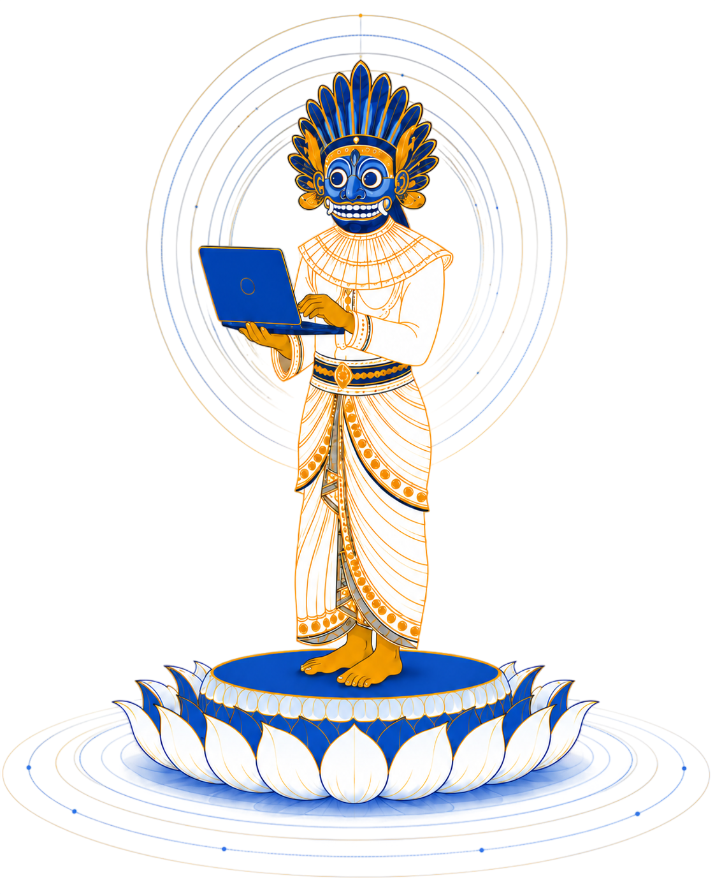

```{=html}

<section class="hero" aria-labelledby="hero-title">
<canvas id="field" aria-hidden="true"></canvas>
<div class="hero-grid">
<div class="copy">
<div id="hero-title" class="hero-heading" role="heading" aria-level="1">Forecasting<br>for a <em>better</em><br><em>tomorrow.</em></div>
<p class="intro">I’m <strong>Harsha Halgamuwe Hewage.</strong><br>I work on forecasting for social good, uncertainty, and decision-making, turning data into practical tools and learning materials for real-world problems.</p>
<div class="actions"><a class="button" href="/projects/">Explore my work <span aria-hidden="true">↗</span></a><a class="text-link" href="/about/">A little about me <span aria-hidden="true">↗</span></a></div><div class="social-icons" aria-label="Social links"><a href="mailto:hewagehrc@gmail.com" aria-label="E-mail" title="E-mail"><i class="bi bi-envelope" aria-hidden="true"></i></a><a href="https://github.com/chamara7h" aria-label="GitHub" title="GitHub"><i class="bi bi-github" aria-hidden="true"></i></a><a href="https://www.linkedin.com/in/harshachamara/" aria-label="LinkedIn" title="LinkedIn"><i class="bi bi-linkedin" aria-hidden="true"></i></a><a href="https://scholar.google.com/citations?user=XgQYqK8AAAAJ&amp;hl=en" aria-label="Google Scholar" title="Google Scholar"><i class="bi bi-mortarboard-fill" aria-hidden="true"></i></a></div>
</div>
<figure class="art"><figcaption>Rooted in Sri Lanka. Looking ahead.</figcaption></figure>
</div>
<div class="hero-bottom"><span class="areas"><i class="dot" aria-hidden="true"></i>Forecasting &nbsp; / &nbsp; Public health &nbsp; / &nbsp; Education</span><button id="motion" type="button" aria-pressed="true">Ⅱ &nbsp; Pause motion</button></div>
</section>
<section class="story" aria-labelledby="story-title"><div><p class="eyebrow">A personal connection</p><h2 id="story-title">A sense of place.<br>A purpose beyond the numbers.</h2></div><div><p>The Wes Muna motifs connect this space to my Sri Lankan roots. For me, they evoke healing and community care, the same spirit of social good that guides my work.</p><a href="/about/">The story behind the artwork <span aria-hidden="true">↗</span></a></div></section>

```
